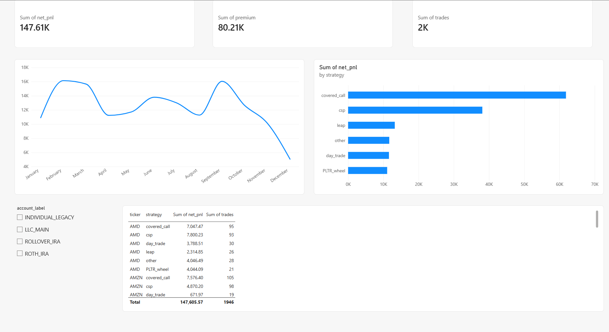
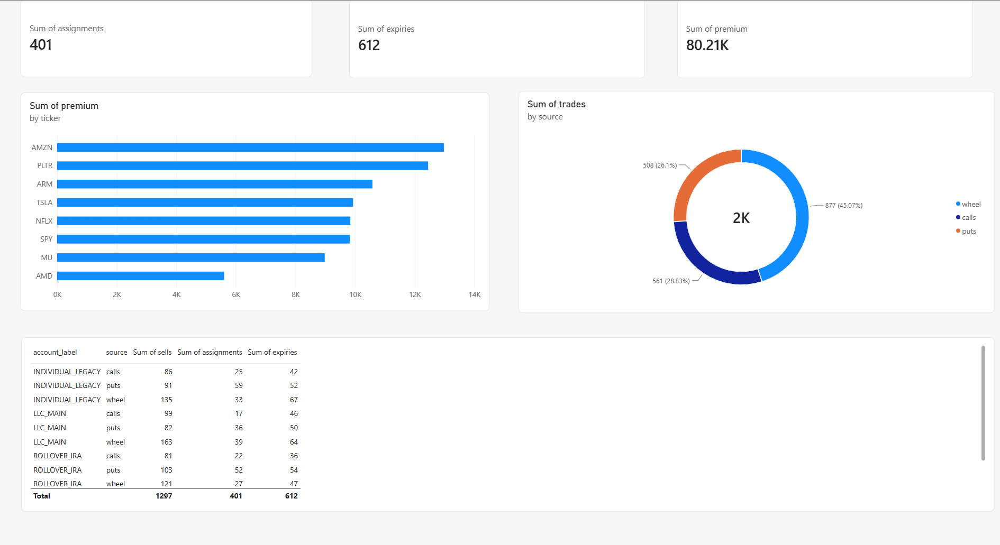
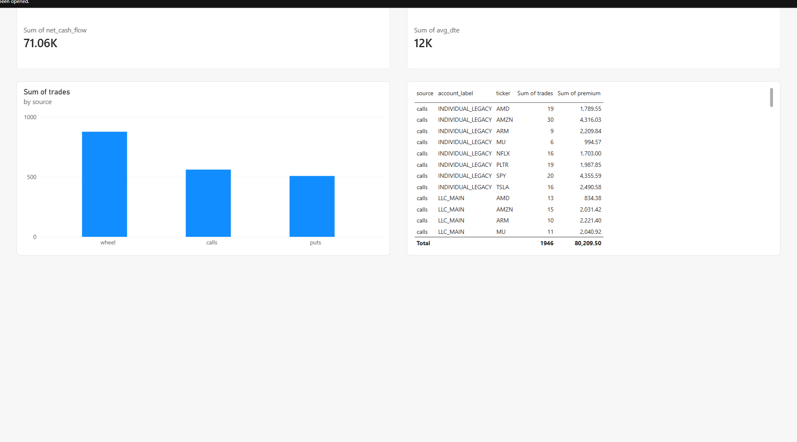
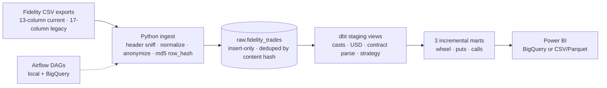

# Options Trading Analytics Pipeline

I trade options — mostly cash-secured puts, covered calls and a small wheel sleeve — and Fidelity
only gives me CSV exports. This repo is the pipeline I built to turn those exports into something
queryable: a header-sniffing Python ingest step, dbt staging and incremental marts, Airflow DAGs
for scheduling, and a Power BI dashboard on top.

The same medallion design is implemented four ways across three engines (BigQuery, DuckDB,
Databricks) so the tradeoffs are concrete rather than theoretical.


**What's in here:** four implementations across three engines (BigQuery · DuckDB · Databricks) ·
35 pytest + 28 dbt tests including P&L reconciliation · a one-command synthetic demo · a
three-page Power BI report · CI that runs without cloud credentials.

> **No private data in this repository.** Committed data is limited to a synthetic fixture
> (`tests/fixtures/sample_history.csv`) and synthetic Power BI samples under
> `powerbi/sample_data/`. Real exports live outside the repo and are gitignored; account
> numbers are mapped to labels in an untracked `.env` before any row is built. Early planning
> notes that contained account-number examples were removed from the repo and its history.

**Status:** v1.0 tagged and CI green on every push. The local pipeline is verified end to end
(35 pytest + 28 dbt tests); the cloud paths run with the owner's credentials.

| Wheel Overview | CSPs & Covered Calls |
|---|---|
|  |  |

| Data Quality & Ops |
|---|
|  |

*Three-page Power BI report built from the committed synthetic sample data: **Wheel Overview**
(KPI cards, monthly P&L trend, P&L by strategy, account slicer, ticker/strategy detail table),
**CSPs & Covered Calls** (assignments, expiries and premium KPIs, premium by ticker, activity mix
by source, lifecycle by account), and **Data Quality & Ops** (net cash flow, average DTE, trades by
source, source/account/ticker detail). The report (`powerbi/OptionsTrading.pbix`) stays local and
gitignored; these screenshots are public-safe.*

## Why this project

The data is real but private, which turned out to be a useful constraint: anonymize before
ingestion, make loads idempotent, prove the P&L math with reconciliation tests, and keep the
same models portable across engines. I kept the scope to one domain — options trading — rather
than adding breadth for its own sake.

## Architecture



- **Ingest** scans a folder of exports, sniffs the header row (13-column current or 17-column
  legacy format), normalizes dates/numbers, anonymizes account numbers, and computes
  `row_hash = md5(account_label + stable payload + occurrence index)` with `cash_balance`
  excluded. Loads are insert-only.
- **Staging** views cast numerics, convert amounts to USD, parse option contract codes, and
  classify strategy. `stg_fidelity_trades` is the canonical view (reads `raw` directly) and the
  per-account views filter it by label.
- **Marts** are incremental models merged on business keys with a 3-day lookback, partitioned
  by `run_date` on BigQuery.

## Stack

| Layer | Tools |
|---|---|
| Language | Python 3.11, `uv`-managed venv |
| Ingestion | stdlib `csv`, `python-dotenv`, `google-cloud-bigquery` |
| Transformation / engines | dbt-core with `dbt-bigquery`, `dbt-duckdb`, `dbt-databricks`; engines: BigQuery, DuckDB, Databricks (Spark + Delta) |
| Orchestration / BI | Airflow 3 DAGs, Databricks Workflows (optional), Power BI assets |
| Tests / CI | pytest, dbt generic + singular tests, GitHub Actions, `ruff` |

## Data model

Three incremental marts, one row per business key per day:

| Mart | Grain | Key metrics |
|---|---|---|
| `fct_wheel_mechanics` | `run_date × account_label × ticker × strategy` | `n_trades`, `n_sells`, `n_assignments`, `net_cash_flow`, `net_pnl`, `avg_dte` |
| `fct_cash_secured_puts` | `run_date × account_label × ticker` | `n_puts_sold`, `n_assignments`, `n_expired`, `net_cash_flow`, `net_pnl`, `last_strike` |
| `fct_covered_call_premiums` | `run_date × account_label × ticker` | `n_calls_sold`, `n_called_away`, `n_expired`, `net_cash_flow`, `net_pnl`, `premium_collected` |

Names are kept for continuity, but the marts are activity-level. `net_pnl` is realized
option-premium P&L (Fidelity sign, credits positive) excluding assignment cash; `net_cash_flow`
is total cash including assignments. Both exist on purpose — see D7 in `docs/DECISIONS.md`.

## Anonymization and privacy

- Real account numbers exist **only** in the untracked `.env`, as
  `ACCOUNT_<real number>=<LABEL>` mappings using four labels: `LLC_MAIN`, `ROTH_IRA`,
  `ROLLOVER_IRA`, `INDIVIDUAL_LEGACY`.
- `ingest/` maps each filename to a label and scrubs account numbers out of the filename before
  a row is built; unknown files skip with a warning rather than guessing.
- The warehouse sees labels only — the raw account number never enters the pipeline, so there
  is no query-time PII filter to misconfigure. The repo commits no real CSVs, no `.env`, no
  account numbers, no cloud project IDs, and no workspace URLs or tokens.
- `scripts/privacy_check.py` is a pre-push guard for account-number patterns and secret
  shapes: `python scripts/privacy_check.py`.

## Quickstart: synthetic demo, no private data

Prerequisites: Python 3.11, `uv`, git. On Windows use **WSL2 Ubuntu** (recommended); native
Windows lacks the toolchain.

```bash
git clone https://github.com/helstonrampersad/options-trading-analytics.git
cd options-trading-analytics
./run.sh setup      # .venv with Python 3.11 + pinned dependencies
./run.sh sample     # synthetic fixture -> data/sample.duckdb -> dbt run + dbt test
```

`run.sh sample` copies the fixture into a temp folder, writes a temporary mapping for it,
loads `data/sample.duckdb`, then runs the DuckDB dbt project and its full test suite — no real
exports, no cloud, no network. Inspect it with any DuckDB client. The raw commands behind it:

```bash
printf 'FILE_sample_history=LLC_MAIN\n' > /tmp/options-demo.env
python -m ingest.duckdb_loader --db data/sample.duckdb \
  --source-dir tests/fixtures --env /tmp/options-demo.env
DUCKDB_PATH=$PWD/data/sample.duckdb dbt run  --project-dir dbt_local --profiles-dir dbt_local
DUCKDB_PATH=$PWD/data/sample.duckdb dbt test --project-dir dbt_local --profiles-dir dbt_local
```

## Full local run with your own exports

```bash
cp .env.example .env    # add ACCOUNT_<real number>=<LABEL>; never commit it
./run.sh full           # first load: ingest ../optionsDayTrade + dbt run --full-refresh
./run.sh daily          # afterwards: incremental ingest + run
./run.sh test           # 35 pytest + 28 dbt tests
```

The CSV source folder defaults to `../optionsDayTrade`; override with
`SOURCE_DIR=/path/to/csvs ./run.sh daily`. Backlog CSVs with old dates need `./run.sh full`
because incremental marts only rescan a 3-day window. `make local` / `make test-local` are
equivalent if `make` is installed. Editing layers and troubleshooting: `docs/USAGE.md`.

## BigQuery run

The BigQuery project uses Application Default Credentials and environment variables; no
project ID or credentials are committed.

```bash
gcloud auth application-default login
cp .env.example .env          # account mappings + your GCP_* settings
export GCP_PROJECT_ID=<your-gcp-project> GCP_REGION=US
python -m ingest.ingest --source-dir ../optionsDayTrade
dbt run  --project-dir dbt_project --profiles-dir dbt_project
dbt test --project-dir dbt_project --profiles-dir dbt_project
```

Datasets are `raw` (landing), `analytics_staging` (views), and `analytics_marts` (incremental
tables partitioned by `run_date`). The region must match where the raw dataset was created (US
multi-region). Loaders are idempotent: re-running the ingest inserts only rows with a new
`row_hash`.

## Databricks notes

Two Databricks paths implement the same design:

- `databricks/options_pipeline.py` — single-file PySpark/Delta medallion notebook
  (bronze → silver → gold, partitioned by `run_date`, MERGE upserts). Import it, add your
  account mapping as local `%env` lines in the CONFIG cell, and Run All.
- `dbt_databricks/` — the same dbt models in Spark SQL against a workspace SQL warehouse.
  Supply `DATABRICKS_HOST`, `DATABRICKS_HTTP_PATH`, and a short-lived `DATABRICKS_TOKEN`,
  then run `dbt run --project-dir dbt_databricks --profiles-dir dbt_databricks` (and `dbt test`).

Both target Databricks Free Edition; CI runs only a credential-free `dbt parse` for this project.

## Power BI

A working **three-page Power BI dashboard** is included in `powerbi/`, built on the committed
synthetic sample data so it can be shown publicly (screenshots at the top of this README). It
uses the combined dataset from `build_dashboard_dataset.py`:

- **Wheel Overview** — KPI cards, monthly P&L trend, P&L by strategy, account slicer, and a
  ticker/strategy detail table.
- **CSPs & Covered Calls** — assignments/expiries/premium KPIs, premium by ticker, activity mix by
  source, and put/call/wheel lifecycle by account.
- **Data Quality & Ops** — net cash flow, average DTE, trades by source, and source/account/ticker
  detail.

```bash
make powerbi        # or: ./run.sh powerbi
# -> data/exports/powerbi/dashboard.csv  (single-table import; gitignored)
```

The report is `powerbi/OptionsTrading.pbix` (kept local, gitignored). To rebuild or extend it, follow
`powerbi/dashboard-spec.md`; DAX measures, the report theme, and the data dictionary live in the
same folder.

## Testing and CI

Local verification (2026-11-09, Python 3.11 + dbt on DuckDB): `pytest tests/ -q` → **35 passed**;
`dbt test` → **PASS=28, ERROR=0**.

- **35 pytest tests** cover anonymization, config, parsing (both header formats), hashing, and loaders.
- **28 dbt tests per project**: 25 generic schema tests plus 3 singular P&L reconciliation SQL
  tests that compare staging cash flow against each mart per account/day and fail over $0.01.

`.github/workflows/ci.yml` runs on every push, PR, and manual dispatch: `ruff`, pytest, the
full local DuckDB pipeline on the synthetic fixture, and a credential-free `dbt parse` for the
cloud projects. All runs are green (see the badge) and no cloud credentials are used.

## Orchestration

- `airflow/dags/`: `options_pipeline_local` (DuckDB) and `options_pipeline_bigquery`
  (ingest → `dbt run` → `dbt test`), weekday schedule, retries, no catch-up. See `airflow/README.md`.
- Databricks Workflows can schedule the notebook on Free Edition. These are authored
  definitions only — this repo does not claim deployed scheduled runs.

## Project structure

```
ingest/            Python: config, anonymization, CSV parser, BigQuery + DuckDB loaders
dbt_project/       dbt models for BigQuery (staging views + incremental marts)
dbt_local/         dbt models for DuckDB (fully local, used by tests and CI)
dbt_databricks/    dbt models for Databricks (Spark SQL)
databricks/        Single-file PySpark/Delta medallion notebook
airflow/           Airflow DAGs for the local and BigQuery pipelines
powerbi/           Power BI assets: export script, DAX, theme, data dictionary, samples
scripts/           Pre-push privacy check (account numbers / secret shapes)
tests/             pytest suite + synthetic fixture (the only committed CSV data)
data/              Local DuckDB databases and raw export drop folder (gitignored)
docs/              Design decisions, runbook, status, curriculum
```

## Design decisions

`docs/DECISIONS.md` explains the non-obvious choices in interview-ready form: anonymization
(D1), content-hash identity (D2), insert-only raw vs merge marts (D3–D4), the same design
across engines (D5), reconciliation tests (D6), `net_pnl` vs `net_cash_flow` (D7), and Power BI
(D8). More docs: `docs/USAGE.md`, `docs/PROJECT_STATUS.md`, `docs/DBT_PRACTICE.md`,
`docs/MCP_AGENT_LAYER.md` (parked future work).

## Notes from the build

A few things that bit me, kept here because they don't show up on the architecture diagram:

- Fidelity's export shape drifts by year — 13 columns now, 17 in the 2023–2025 files, and one
  file uses CR-only line endings. The ingest sniffs the header row instead of assuming a schema.
- DuckDB is single-writer. One DBeaver tab with the database open is enough to make
  `./run.sh daily` fail with a lock error.
- The 3-day lookback on the incremental marts means back-filling older CSVs needs
  `./run.sh full`.
- The Airflow and Databricks code is real but doesn't run on a scheduler in this repo —
  deploying it is a deliberate next step, not something I'll pretend is live.
- The Power BI build I used doesn't expose theme import through the View tab, so the dashboard is
  default-styled with manual layout rather than using the navy/teal theme in `powerbi/theme.json`.

## Roadmap

- Polish the Power BI report: custom theme/DAX measures for friendlier titles, a report header,
  and keep the committed screenshots current.
- Generate `dbt docs` and link a lineage screenshot.
- Deploy the Airflow DAGs to a scheduler (or schedule the notebook via Databricks Workflows).

## License

MIT — see [LICENSE](LICENSE).
